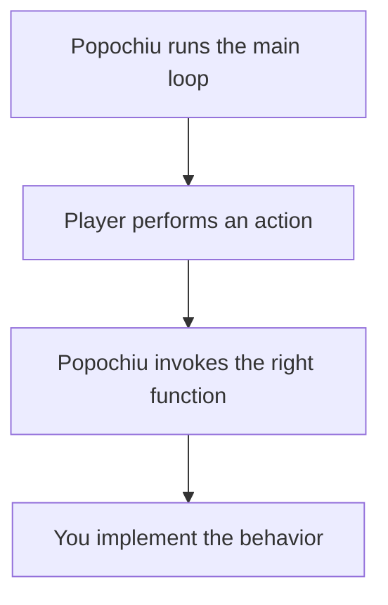

# How Popochiu Works

Popochiu has two halves that work together:

| Part | Runs in | Responsibility |
| :--- | :------ | :------------- |
| Editor plugin | The Godot editor | Creates and configures game objects, scenes, project settings, and editor tools. |
| Runtime engine | Your game | Loads the game, handles input, routes interactions, and provides common adventure-game behavior. |

The practical rule is: **use the editor to configure your game; use scripts to define its behavior.**

## Event-driven by design

You do not write a game loop. Popochiu runs the main loop and calls the right function when something happens. When the player clicks a door, picks up an item, or talks to a character, Popochiu invokes a function on the relevant game object. Your job is to fill in that function with the behavior you want.

This is why Popochiu games feel different from a generic Godot project: instead of polling input every frame, you react to events.

## The pieces you will use

- **Game objects** such as rooms, characters, props, hotspots, inventory items, and dialog trees. They hold the data and the callbacks for each part of your game.
- **Singletons** such as `C` for characters, `R` for rooms, `I` for inventory, and `E` for the engine. They give you a stable entry point to the game from any script.
- **Virtual functions** such as `_on_click()` or `_on_interact()`. These are the hooks Popochiu calls on your objects.
- **Queues and `await`** for sequences of actions: walk here, say this, pick that up, then open a dialog.

## Where to go next

- [The Popochiu Editor Atlas](popochiu-editor-atlas.md) shows the tools the plugin adds to the editor.
- [Understanding Game Objects](understanding-game-objects.md) introduces the entities your game is made of.
- [Your First Adventure](../../your-first-adventure/introduction.md) puts these ideas into practice.
- [Scripting Overview](../../guides/scripting/scripting-overview.md) goes deeper into the runtime side.
