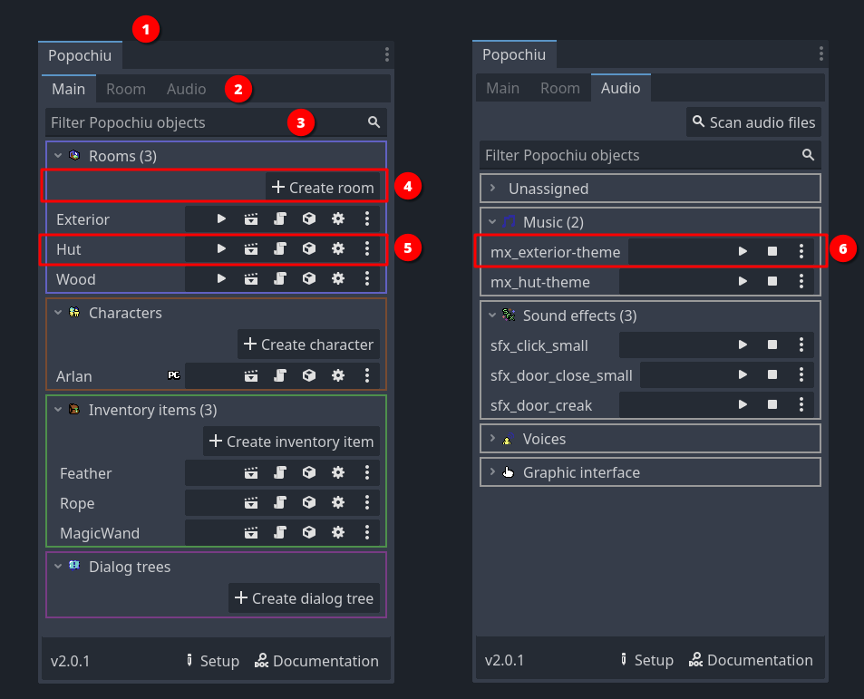

# The Popochiu Editor Atlas

Popochiu adds a small set of tools to the Godot editor. This page is a map of those tools: what they are, when to use them, and where to read the details.

| Tool | What it is | When to use it | Learn more |
| :--- | :--------- | :------------ | :--------- |
| **Popochiu dock** | The main panel in the editor's right sidebar, with tabs for the main objects, the current room, audio, and tools. | Create, find, and open rooms, characters, inventory items, dialogs, and room objects. | [Popochiu Dock](../../reference/editor-reference/popochiu-dock.md) |
| **Scene toolbar and gizmos** | Contextual tools in the 2D editor for positioning and drawing Popochiu objects. | Set baselines, walk-to points, hotspots, walkable areas, and regions. | [Toolbar and Gizmos](../../reference/editor-reference/toolbar-and-gizmos.md) |
| **Setup wizard** | The initial project configuration dialog. | Configure the game for the first time or reopen it from the dock. | [Game Setup](../../your-first-adventure/game-setup/game-setup.md) |
| **Importers** | Aseprite importers that turn source files into Popochiu rooms, characters, and inventory items. | Import art with layers, frames, and metadata instead of building objects by hand. | [Importers](../../reference/editor-reference/importers.md) |
| **Editor and Project Settings** | Popochiu-specific settings added to Godot's settings dialogs. | Change engine-wide defaults and per-project options. | [Editor Settings](../../reference/editor-reference/editor-settings.md) |

## How to read this atlas

You do not need to memorize every tool. Start with the dock, because it is the entry point for most workflows. When a task asks you to draw a shape or place a point, look for the scene toolbar and gizmos. When the task is about importing art, use an importer.

The Reference pages describe controls and options in detail. The guides show complete workflows. Use the atlas to decide which one you need.

## Where to go next

- [Understanding Game Objects](understanding-game-objects.md) explains what these tools create.
- [Your First Adventure](../../your-first-adventure/introduction.md) uses the tools step by step.
