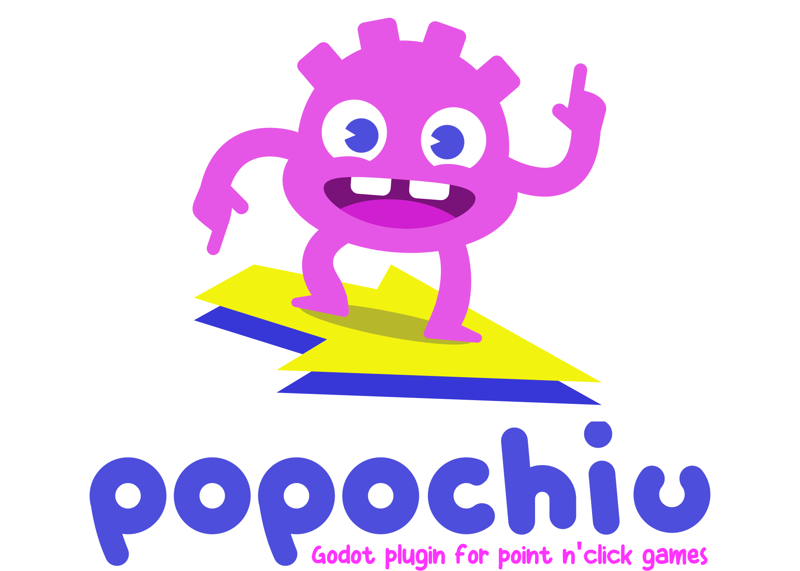

**Popochiu is the most developer-friendly addon for creating point-and-click adventure games in Godot.**

## Start here

New to Popochiu? Read [What is Popochiu?](getting-started/what-is-popochiu.md) and [install the plugin](getting-started/installing-popochiu.md).

Then build your mental model with **Understanding Popochiu**. This orientation is recommended regardless of your previous Godot experience:

* [How Popochiu Works](getting-started/understanding-popochiu/how-popochiu-works.md)
* [The Popochiu Editor Atlas](getting-started/understanding-popochiu/popochiu-editor-atlas.md)
* [Understanding Game Objects](getting-started/understanding-popochiu/understanding-game-objects.md)

## Learn by building

Follow [Your First Adventure](your-first-adventure/introduction.md), a step-by-step tutorial that takes you from an empty project to a small playable adventure.

## Browse guides by topic

* [Characters](guides/characters/character-animation-prefix.md)
* [Dialogues](guides/dialogues/change-text-to-gibberish.md)
* [Scripting](guides/scripting/scripting-overview.md)
* [GUI](guides/gui/guis.md)
* [Save and Load](guides/save-and-load/game-state-saving-and-loading.md)
* [Localization](guides/localization/localization.md)

## Look up details

* [Editor Reference](reference/editor-reference/editor-settings.md)
* [Scripting API](reference/scripting-api/index.md)

## Contribute

Popochiu is a community effort. Start with [Basic Rules](contributing/basic-rules.md), then explore the [Contributing](contributing/basic-rules.md) section.
