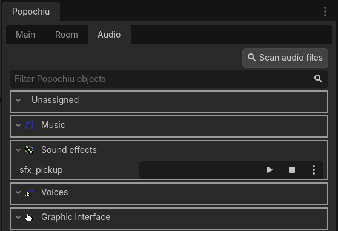
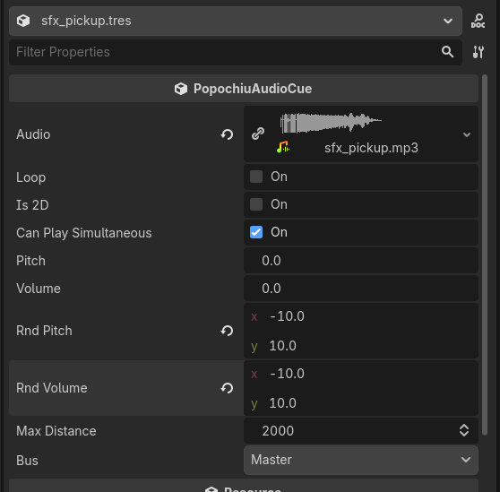
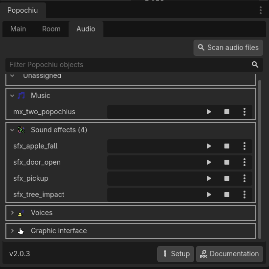
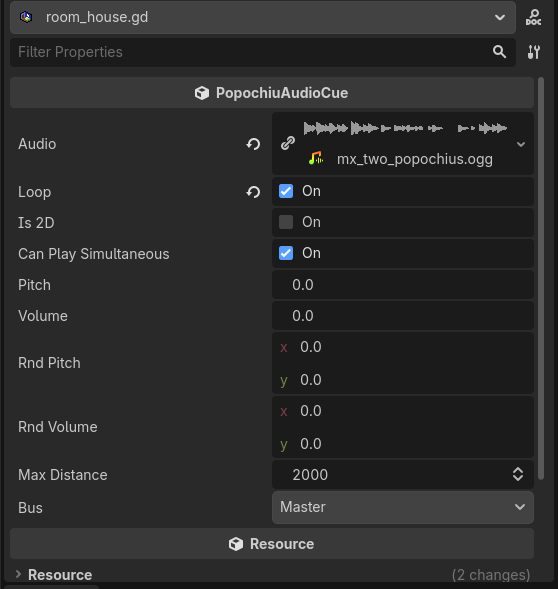

## Adding Music and Sound

There are four kinds of audio clips in Popochiu:

1. Music
2. Sound effects
3. Voices
4. GUI sounds

Each sound corresponds to an AudioCue resource file.

!!! note
	Popochiu will classify audio clips automatically based on the filename prefix:

	1. Music: mx_
	2. Sound effects: sfx_
	3. Voices: vo_
	4. GUI ui_

	Files without any of these prefixes will be categorized as 'Not assigned'.

### Add a pickup sound effect

[Earlier in the tutorial](../inventory/add-an-inventory-item.md), we added an inventory item, a toy car, that you can pick up and add to your inventory. We'll now make this interaction juicier by playing a sound effect.

First, download an appropriate sound effect. There are plenty of royalty-free public domain sound effects on [FreeSound.org](http://freesound.org) or [Pixabay](http://pixabay.com). Let's use [this one](https://pixabay.com/sound-effects/film-special-effects-pickup-sound-82314/) for the tutorial.

Download the audio file and rename it to `sfx_pickup.mp3`, following Popochiu's naming conventions. Then drag and drop it into the project.

 

From within the Inspector, the sound clip's properties can be adjusted. For instance, you can specificy a random value to vary the pitch and volume every time it's played. It can also be assigned to a separate audio bus, to allow the player to adjust the volume of music and sound effects separately.

 

To play the audio in-game, edit the script for the ToyCar prop and play the pickup audio as the playe interacts with it, like so:

```gdscript
func _on_click() -> void:
	await C.player.walk_to_clicked()
	await C.player.face_clicked()
	await C.player.say("Better pick this up, before someone slips on it!")
	A.sfx_pickup.play()
	R.get_prop("ToyCar").hide()
	await I.ToyCar.add()
```

Run the game and interact with the toy car prop to test it in the game!

### Add background music

Finally, we'll add music to the game. Download [this sample music clip](https://github.com/carenalgas/popochiu-sample-game/blob/main/game/rooms/house/audio/mx_two_popochius.ogg) from the Popochiu sample project and add it to the game's folder. It'll show up automatically in the Popochiu editor.
xo


From here, the music can also be edited. Make sure that Loop is checkd so that the background music loops seamlessly. We might also wait to raise or lower the volume.



To play the music in the game, open the script for the room, and update the on_room_entered() function, as so:

```gdscript
func _on_room_entered() -> void:
	A.mx_two_popochius.play()
```

To fade in the music gradually, we can either pass in a parameter, as such:

```gdscript
func _on_room_entered() -> void:
	A.mx_two_popochius.play(3.0)
```

Or call `fade` to specify a start and end volume to fade from and to, as such.

```gdscript
func _on_room_entered() -> void:
	A.mx_two_popochius.fade(3.0, false, -20.0, INF)
```

Run the game and test it out!
