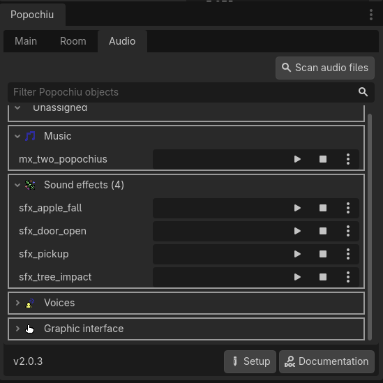
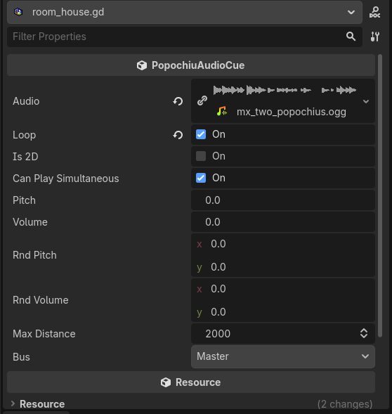

### Add background music

Finally, we'll add music to the game. Download [this sample music clip](https://github.com/carenalgas/popochiu-sample-game/blob/main/game/rooms/house/audio/mx_two_popochius.ogg) from the Popochiu sample project and add it to the game's folder. It'll show up automatically in the Popochiu editor.



From here, the music can also be edited. Make sure that Loop is checkd so that the background music loops seamlessly. We might also wait to raise or lower the volume.



To play the music in the game, open the script for the room, and update the on_room_entered() function, as so:

```gdscript
func _on_room_entered() -> void:
	A.mx_two_popochius.play()
```

To fade in the music gradually, we can either pass in a parameter, as such:

```gdscript
func _on_room_entered() -> void:
	A.mx_two_popochius.play(3.0)
```

Or call `fade` to specify a start and end volume to fade from and to, as such.

```gdscript
func _on_room_entered() -> void:
	A.mx_two_popochius.fade(3.0, false, -20.0, INF)
```

Run the game and test it out!
