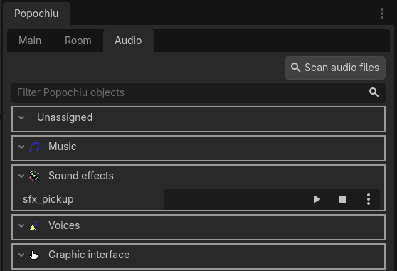
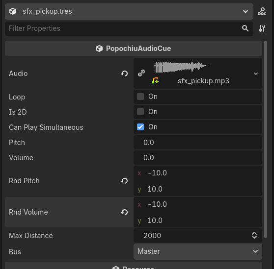

### Add a pickup sound effect

[Earlier in the tutorial](../inventory/add-an-inventory-item.md), we added an inventory item, a toy car, that you can pick up and add to your inventory. We'll now make this interaction juicier by playing a sound effect.

First, download an appropriate sound effect. There are plenty of royalty-free public domain sound effects on [FreeSound.org](http://freesound.org) or [Pixabay](http://pixabay.com). Let's use [this one](https://pixabay.com/sound-effects/film-special-effects-pickup-sound-82314/) for the tutorial.

Download the audio file and rename it to `sfx_pickup.mp3`, following Popochiu's naming conventions. Then drag and drop it into the game's folder (anywhere in the project hierarchy is fine).

 

From within the Inspector, the sound clip's properties can be adjusted. For instance, you can specificy a random value to vary the pitch and volume every time it's played. It can also be assigned to a separate audio bus, to allow the player to adjust the volume of music and sound effects separately. To learn more about how audio buses work in Godot, check out the [official documentation](https://docs.godotengine.org/en/stable/tutorials/audio/audio_buses.html).

 

To play the audio in-game, edit the script for the ToyCar prop and play the pickup audio as the player interacts with it, like so:

```gdscript
func _on_click() -> void:
	await C.player.walk_to_clicked()
	await C.player.face_clicked()
	await C.player.say("Better pick this up, before someone slips on it!")
	A.sfx_pickup.play()
	R.get_prop("ToyCar").hide()
	await I.ToyCar.add()
```

Run the game and interact with the toy car prop to test it in the game!
